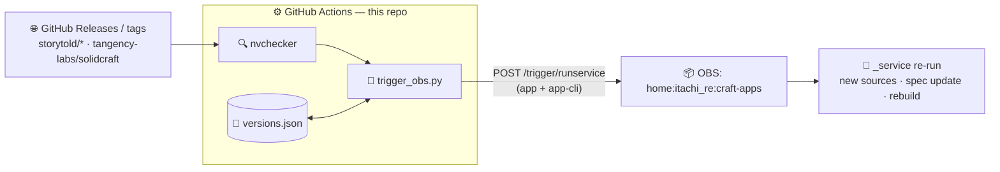
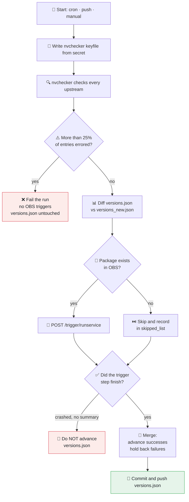

<div align="center">

# 🛠️ OBS Craft Auto-Trigger

**Automated upstream release tracking & OBS rebuilds for the 38 packages of `home:itachi_re:craft-apps`**

[](https://github.com/itachi-re/obs-craft-auto-trigger/actions/workflows/check-updates.yml)
[](https://build.opensuse.org/project/show/home:itachi_re:craft-apps)
[](nvchecker.toml)
[](#whats-tracked)
[](.github/workflows/check-updates.yml)

[](https://github.com/itachi-re/obs-craft-auto-trigger/commits/main)
[](https://github.com/itachi-re/obs-craft-auto-trigger/graphs/commit-activity)
[](https://github.com/itachi-re/obs-craft-auto-trigger/issues)
[](https://github.com/itachi-re/obs-craft-auto-trigger/stargazers)
[](LICENSE)

[](https://nvchecker.readthedocs.io/)
[](https://www.python.org/)
[](https://github.com/features/actions)

<sub>Automated release tracking for the openSUSE Build Service project <a href="https://build.opensuse.org/project/show/home:itachi_re:craft-apps"><code>home:itachi_re:craft-apps</code></a>, packaging the Rust-based <i>Crafting Apps</i> suite (PhotoCraft, PdfCraft, WordCraft, MaterialCraft, SolidCraft and friends), plus ArtCraft and the ArtCraft Launcher.</sub>

</div>

---

A GitHub Actions cron job checks every upstream release feed with [nvchecker](https://nvchecker.readthedocs.io/) every **6 hours**. The moment any app publishes a new stable release, it fires an OBS service run for that app **and** its `-cli` twin (where it has one), so OBS rebuilds without any manual work.

This is the single-project sibling of [`obs-auto-trigger`](https://github.com/itachi-re/obs-auto-trigger): same engine, same safety rules, but scoped to **one** OBS project and **one** upstream family, so the config stays small and a problem here can never affect the 100+ packages in `home:itachi_re`.



**Highlights**

- ⏱️ Watches **20 upstream repos → 38 OBS packages** every 6 hours, with manual runs on demand
- 👯 **App + `-cli` pairs move together**: one upstream release triggers both packages
- 🧯 **Pre-release proof**: release candidates and nightlies (SolidCraft publishes both) never trigger a build
- 🏷️ **Releases or tags**: apps with GitHub Releases follow those; apps without any (AniCraft) follow tags
- 🛡️ Fails safe: a bad run can never silently lose or duplicate an update
- 🧪 Built-in dry-run and single-package force-trigger modes
- 🔎 Preflight check: packages missing from OBS are skipped, never counted as failures
- 🔨 Optional build polling to wait for OBS results (for local or custom runs)
- 🔐 Least privilege: no `pull_request` trigger, secrets never stored in the repo

---

## 📑 Table of Contents

<details open>
<summary><b>Click to expand / collapse</b></summary>

<br>

1. [📦 What's tracked](#whats-tracked)
2. [🔧 How it works](#how-it-works)
3. [🛡️ Safety guarantees](#safety-guarantees)
4. [📋 Requirements](#requirements)
5. [🚀 One-time setup](#one-time-setup)
6. [🗓️ Day-to-day usage](#day-to-day-usage)
7. [⌨️ `trigger_obs.py` reference](#trigger_obspy-reference)
8. [⚙️ Configuring nvchecker](#configuring-nvchecker)
9. [➕➖ Adding or removing an app](#adding-or-removing-an-app)
10. [🔒 Security notes](#security-notes)
11. [🩺 Troubleshooting](#troubleshooting)
12. [🧰 Maintenance](#maintenance)
13. [📁 File reference](#file-reference)

</details>

---

## What's tracked

**18 apps** are one upstream repo and **two OBS packages** each (the GUI app and its `-cli` twin, both built from the same upstream release). **ArtCraft and the ArtCraft Launcher** are single packages with no `-cli`. In total that is 20 upstream repos, 38 OBS packages and 38 entries in [`nvchecker.toml`](nvchecker.toml).

| OBS packages | Upstream repo | What it is | Version source |
|---|---|---|---|
| `photocraft` · `photocraft-cli` | [storytold/photocraft](https://github.com/storytold/photocraft) | Image editing | Releases |
| `vectorcraft` · `vectorcraft-cli` | [storytold/vectorcraft](https://github.com/storytold/vectorcraft) | Vector graphics | Releases |
| `lightcraft` · `lightcraft-cli` | [storytold/lightcraft](https://github.com/storytold/lightcraft) | Photo library & RAW development | Releases |
| `filmcraft` · `filmcraft-cli` | [storytold/filmcraft](https://github.com/storytold/filmcraft) | Video editing | Releases |
| `effectcraft` · `effectcraft-cli` | [storytold/effectcraft](https://github.com/storytold/effectcraft) | Motion graphics & VFX | Releases |
| `anicraft` · `anicraft-cli` | [storytold/AniCraft](https://github.com/storytold/AniCraft) | 2D vector animation | **Tags** (no Releases) |
| `soundcraft` · `soundcraft-cli` | [storytold/soundcraft](https://github.com/storytold/soundcraft) | Audio / music production | Releases |
| `designcraft` · `designcraft-cli` | [storytold/designcraft](https://github.com/storytold/designcraft) | Page layout | Releases |
| `figcraft` · `figcraft-cli` | [storytold/figcraft](https://github.com/storytold/figcraft) | Interface design | Releases |
| `texturecraft` · `texturecraft-cli` | [storytold/texturecraft](https://github.com/storytold/texturecraft) | 3D texture painting | Releases |
| `materialcraft` · `materialcraft-cli` | [storytold/materialcraft](https://github.com/storytold/materialcraft) | Node-based procedural materials | Releases |
| `pdfcraft` · `pdfcraft-cli` | [storytold/pdfcraft](https://github.com/storytold/pdfcraft) | PDF editing | Releases |
| `wordcraft` · `wordcraft-cli` | [storytold/wordcraft](https://github.com/storytold/wordcraft) | Word processor | Releases |
| `gridcraft` · `gridcraft-cli` | [storytold/gridcraft](https://github.com/storytold/gridcraft) | Spreadsheets | Releases |
| `deckcraft` · `deckcraft-cli` | [storytold/deckcraft](https://github.com/storytold/deckcraft) | Presentations | Releases |
| `cadcraft` · `cadcraft-cli` | [storytold/cadcraft](https://github.com/storytold/cadcraft) | 2D CAD drawing | Releases |
| `solidcraft` · `solidcraft-cli` | [tangency-labs/solidcraft](https://github.com/tangency-labs/solidcraft) | Parametric 3D CAD | Releases (stable only) |
| `craft-anything` · `craft-anything-cli` | [storytold/craft-anything](https://github.com/storytold/craft-anything) | Explore and build your own software variants | Releases |
| `artcraft` | [storytold/artcraft](https://github.com/storytold/artcraft) | AI image and video creation studio | Releases (`artcraft-vX.Y.Z` tags, prefix stripped) |
| `artcraft-launcher` | [storytold/craft-launcher](https://github.com/storytold/craft-launcher) | Installer, updater and launcher for the Craft apps | Releases (`vX.Y.Z` tags, prefix stripped) |

> [!NOTE]
> **SolidCraft is the odd one out.** It lives in a different GitHub org (`tangency-labs`, formerly `bherbruck/solidcraft`, which now redirects there) and publishes `-rc.N` and `-nightly.*` releases alongside stable ones. The config uses the canonical repo name and only follows **stable** releases. See [Configuring nvchecker](#configuring-nvchecker).

> [!NOTE]
> **AniCraft publishes no GitHub Releases** (as of 2026-11-14), so `use_latest_release` would error for it and nvchecker would silently skip the key. Its two entries follow **tags** instead (`use_latest_tag`). Tags do not filter out pre-releases the way Releases do; if AniCraft starts tagging `-rc` or `-nightly`, add an `exclude_regex`. Once it publishes real Releases, switch both entries back to `use_latest_release`.

> [!NOTE]
> **`artcraft` and `artcraft-launcher` have no `-cli` twin** and strip the tag prefix (`artcraft-v` and `v`), so their versions are stored without a leading `v` (for example `0.41.1`). All other entries keep the upstream tag as-is (`v0.20.1`).

---

## How it works

### 🧩 Components

| Component | Role |
|---|---|
| 📄 `nvchecker.toml` | Declares **where** to find the latest release of every package (38 entries, 20 upstreams) |
| 📄 `versions.json` | Last-known version of each package (committed to git) |
| ⚙️ `.github/workflows/check-updates.yml` | Runs nvchecker, analyses the result, fires OBS triggers, commits `versions.json` |
| 🚀 `scripts/trigger_obs.py` | Compares old vs. new versions and calls the OBS API for every changed package |

### ⏱️ Workflow triggers

| Trigger | When |
|---|---|
| 🕒 **Schedule** | Every 6 hours, at minute 17 (`17 */6 * * *`). The odd minute avoids the top-of-the-hour rush that delays GitHub cron jobs. |
| 📤 **Push to `main`** | Only when `nvchecker.toml`, `scripts/**` or `.github/workflows/**` change |
| 🖱️ **Manual** | *Actions → Run workflow* (supports dry run and force-trigger) |

> [!TIP]
> Upstream ships releases very frequently. A 6-hour cadence is deliberate: it batches several upstream releases into a single OBS rebuild instead of rebuilding a Rust app for every one. To react faster, change the cron line; with only 38 lookups per run the GitHub API budget is not a concern.

### 🔄 What one run does



### 📡 The OBS API call

For each package whose version changed, `trigger_obs.py` calls:

```http
POST https://api.opensuse.org/trigger/runservice
     ?project=home:itachi_re:craft-apps
     &package=<PACKAGE_NAME>
Authorization: Token <OBS_TOKEN>
```

That runs the package's `_service` file, which fetches the new upstream sources, updates the version in the `.spec`, and queues a rebuild. ✨

Before each trigger, the script also does a lightweight `GET /source/{project}/{package}` to confirm the package exists. A `404` means the package is skipped (a stale `nvchecker.toml` entry can never break the pipeline). Any other response is treated as "might exist" and the trigger call surfaces the real error.

> [!IMPORTANT]
> `runservice` only does something for packages that **have their own `_service` file**. If a package is a bare `_link` branch, it has nothing to run. See [step 3 of setup](#one-time-setup).

> [!IMPORTANT]
> The trigger only asks OBS to re-run `_service`; the version that ends up in the build comes from the service itself (`obs_scm` with `@PARENT_TAG@`). `obs_scm` returns the newest tag reachable from the `revision` branch, so make sure each package's `_service` points at the branch that actually carries the release tags (for example `release` instead of `main`). Otherwise OBS keeps building an older version than the one nvchecker reports.

---

## Safety guarantees

The workflow is built so that a bad run **cannot silently lose or duplicate updates**.

| 🎯 Situation | ✅ Behaviour |
|---|---|
| A few upstream checks fail (rate limit, repo hiccup, a repo with no Releases) | Annotated in the run and skipped; everything else proceeds. Failed entries retry on the next run. |
| More than `MAX_ERROR_RATIO` (default **25 %**, so 10 or more of the 38 entries) fail, or nvchecker writes no output | The run fails **before** any OBS trigger and `versions.json` is left unchanged. |
| nvchecker returns a `null` / empty version for a package | That package is skipped and never written to `versions.json`; it retries next run. |
| Upstream publishes a pre-release (`-rc`, `-nightly`, draft) | Ignored for entries using `use_latest_release`. Entries using tags need an `exclude_regex` for the same protection. |
| A package does not exist in OBS (preflight returns 404) | Skipped and listed in `skipped_list`. It is not a failure. |
| An OBS trigger fails for one package | That package keeps its old version in `versions.json`, so it is retried next run. The others advance. |
| The trigger step crashes and writes no summary (bad token, script error) | `versions.json` is **not** advanced at all, so no update is lost. |
| Transient network errors calling OBS | Triggers are retried up to 3 times with increasing backoff. |
| Dry run | No OBS calls and no commit. |
| Force-trigger run | Triggers only the named package and does **not** commit `versions.json`. |
| Concurrent runs | Serialised by a concurrency group; a second run queues behind the first. |
| Push races with another commit | Commit first, then `git pull --rebase --autostash`, with up to 3 push attempts. |

---

## Requirements

| Requirement | Version / notes |
|---|---|
| 🐍 **Python** | **3.14** in CI (set by `PYTHON_VERSION` in the workflow). The scripts only need 3.11+ (`tomllib`, modern type hints). |
| 🔍 **nvchecker** | Installed with `pip install nvchecker` |
| 🌐 **requests** | Used by `trigger_obs.py` |
| 🧰 **jq** | Preinstalled on `ubuntu-latest`; used by the rate-limit check |
| 🔑 **OBS token** | `runservice` operation, not bound to a single package |

---

## One-time setup

### 1️⃣ Create the OBS token

> [!NOTE]
> The token needs the `runservice` operation and must **not** be bound to a single package. If you already created such a token for `obs-auto-trigger`, you can reuse its value here: it works for any project your account can write to. GitHub secrets are per repository, so you still have to add it to this repo (step 2).

```bash
# Install osc if needed
zypper install osc          # openSUSE
# or: pip install osc

# First run walks you through configuring credentials
osc

# Create a runservice token
osc api -X POST "/person/itachi_re/token?operation=runservice"
```

The response contains the token:

```xml
<status code="ok">
  <summary>Ok</summary>
  <data name="token">abc123xyz789...LONG_TOKEN_STRING...</data>
  <data name="id">42</data>
</status>
```

> [!WARNING]
> Copy the token now. It is shown only **once**.

You can also create it in the web UI: **Profile → Manage Your Tokens → Create Token → Operation: "Run services"**.

### 2️⃣ Add secrets and variables to GitHub

In the repo go to **Settings → Secrets and variables → Actions**.

#### 🔐 Secrets (encrypted)

| Name | Required | Value |
|---|---|---|
| `OBS_TOKEN` | ✅ **yes** | The token from step 1 |
| `NVCHECKER_PAT` | 💡 recommended | A GitHub token used for upstream lookups (see below) |

#### ⚙️ Variables (plain text)

| Name | Required | Default |
|---|---|---|
| `OBS_PROJECT` | ❌ no | `home:itachi_re:craft-apps` |

<details>
<summary><b>ℹ️ About <code>NVCHECKER_PAT</code></b></summary>

<br>

nvchecker only needs to *read public repositories*, so create a **fine-grained personal access token** with **"Public repositories (read-only)"** and no other permissions.

If the secret is not set, the workflow falls back to the built-in `GITHUB_TOKEN` (about **1,000** API requests/hour). With 38 lookups per run, every 6 hours, that is far more than enough; a PAT (5,000 requests/hour) just gives extra headroom. If you already have a PAT for `obs-auto-trigger`, reuse it.

</details>

### 3️⃣ Verify the packages can run a service

`runservice` executes the package's own `_service` file. Confirm each package holds real sources and not just a link to another project:

```bash
osc ls home:itachi_re:craft-apps pdfcraft
```

| What you see | Meaning |
|---|---|
| `_service` is listed (usually with a `.spec`, maybe a `_service:*` tarball) | ✅ Good: the trigger will work |
| Only `_link` | ⚠️ A bare branch: it has no `_service` of its own, so `runservice` has nothing to run. Turn it into a real copy first with `osc detachbranch home:itachi_re:craft-apps pdfcraft` (check `osc help detachbranch`), then add or adjust the `_service` file. |

Also confirm that the repo's package list and `nvchecker.toml` agree. This prints nothing when they match (38 lines on each side):

```bash
diff <(osc ls home:itachi_re:craft-apps | sort) \
     <(grep -oP '^\[\K[^\]]+' nvchecker.toml | grep -v '^__config__$' | sort)
```

To check out the whole project locally:

```bash
osc co home:itachi_re:craft-apps
```

### 4️⃣ Review `nvchecker.toml` and `versions.json`

Both files ship pre-filled:

- [`nvchecker.toml`](nvchecker.toml) has all 38 entries, matching the package list of the OBS project.
- [`versions.json`](versions.json) is **seeded with the latest stable upstream versions**, so the first run does not rebuild all 38 packages at once.

> [!TIP]
> **Want the first run to refresh everything?** Replace `versions.json` with `{}` before the first push. Every package then looks new and all 38 get triggered once. Expect a big queue of Rust builds on OBS.
> **Want just one app refreshed?** Keep the seed and use a [force-trigger run](#day-to-day-usage).

To re-seed from scratch later (needs a GitHub token; nvchecker's GitHub source is not usable without one):

```bash
pip install nvchecker

printf '[keys]\ngithub = "ghp_your_token_here"\n' > .nvchecker_keyfile.toml   # git-ignored, never commit

nvchecker -c nvchecker.toml          # writes versions_new.json
cp versions_new.json versions.json   # use it as the baseline
```

> [!WARNING]
> After re-seeding, count the keys: `jq 'length' versions.json` must print **38**. A lower number means some entries errored and were skipped (a common culprit is a repo with no GitHub Releases). Check `nvchecker_errors.log` before committing.

### 5️⃣ Push and verify

```bash
git add .
git commit -m "feat: initial nvchecker setup for craft-apps"
git push
```

Then open **Actions** and wait for the next scheduled run, or click **Run workflow** (a good first test: `dry_run = true`). A healthy run looks like this (illustrative numbers):

```text
Project   : home:itachi_re:craft-apps
Dry run   : False
Preflight : enabled
Polling   : disabled

Packages tracked  : 38
Updates detected  : 2

  pdfcraft: v0.20.0  ->  v0.21.0
    Triggered
  pdfcraft-cli: v0.20.0  ->  v0.21.0
    Triggered

Triggered : 2
Skipped   : 0
Failed    : 0
```

Note how an app and its `-cli` twin always show up as a pair.

---

## Day-to-day usage

Everything is automatic. Check the **Actions** tab occasionally, or watch for the failure email.

### 🖱️ Manual runs

*Actions → Check Craft Upstream Versions & Trigger OBS → Run workflow*

| Input | Effect |
|---|---|
| `dry_run` = `true` | Check versions and show the diff, but call no OBS API and commit nothing |
| `force_package` = `<name>` | Trigger one package immediately, without waiting for a version change (does not touch `versions.json`). Use the exact OBS name, e.g. `pdfcraft`, `pdfcraft-cli` or `artcraft-launcher`. |

> [!NOTE]
> A force run triggers **one** package. To refresh an app and its CLI, run it twice (once per package name).

### 📊 Reading the results

- **Run summary page**: an *nvchecker* table listing every entry that errored (with the real error message), then an *OBS Trigger Summary* with checked / updated / triggered / failed counts.
- **Log annotations**: the first 10 nvchecker errors appear as warnings on the run.
- **Artifacts**: `nvchecker-run-<N>` (kept 14 days) holds `nvchecker_output.jsonl`, `nvchecker_errors.log`, `versions_new.json` and `trigger_summary.json`. The token keyfile is **never** uploaded.

---

## `trigger_obs.py` reference

The workflow calls the script for you, but you can also run it by hand (for example after a local nvchecker run).

```bash
export OBS_TOKEN=your_token
export OBS_PROJECT=home:itachi_re:craft-apps   # optional, this is the default
export DRY_RUN=true                            # optional, skips all HTTP calls

python scripts/trigger_obs.py \
  --old-versions versions.json \
  --new-versions versions_new.json \
  --output-summary trigger_summary.json
```

### 🏳️ Flags

| Flag | Default | Purpose |
|---|---|---|
| `--old-versions` | `versions.json` | Stored versions file |
| `--new-versions` | `versions_new.json` | Fresh nvchecker output |
| `--output-summary` | `trigger_summary.json` | Where the JSON summary is written |
| `--force-package NAME` | *(none)* | Trigger one package regardless of version changes |
| `--skip-preflight` | off | Skip the OBS existence check (slightly faster, less safe) |
| `--poll-builds` | off | After triggering, poll OBS until all builds settle |
| `--poll-timeout SECONDS` | `300` | Maximum time to wait for builds |
| `--poll-interval SECONDS` | `15` | Time between poll cycles |

### 🌱 Environment variables

| Variable | Required | Purpose |
|---|---|---|
| `OBS_TOKEN` | ✅ | OBS API token with the `runservice` operation |
| `OBS_PROJECT` | ❌ | OBS project name (default `home:itachi_re:craft-apps`) |
| `DRY_RUN` | ❌ | `true` to skip all HTTP calls |

### 🔨 Build polling (optional)

> [!NOTE]
> The scheduled workflow does **not** use `--poll-builds`, so runs stay short. Rust builds on OBS can take a long time; use polling locally, or add the flag to the trigger step (and raise `--poll-timeout`) if you want the run to wait for build results.

With `--poll-builds`, after all packages are triggered the script polls `GET /build/{project}/_result?package={pkg}` for every triggered package. Each repository/architecture is classified independently:

| State | Meaning |
|---|---|
| `succeeded` | Build passed |
| `failed` / `unresolvable` / `broken` | Build failed (the script exits non-zero) |
| `disabled` / `excluded` | Skipped by OBS configuration, not counted |
| `scheduled`, `building`, `finished`, `signing`, `dispatching`, `blocked` | Still in progress, keep polling |

If the timeout expires first, the remaining packages are reported as `timed_out` (also non-zero exit).

### 🧾 Summary file

`trigger_summary.json` contains:

```json
{
  "checked": 38,
  "updated": 2,
  "triggered": 2,
  "skipped": 0,
  "failed": 0,
  "updated_list":  [{"package": "...", "old": "...", "new": "...", "status": "OK"}],
  "skipped_list":  [{"package": "...", "reason": "not found in OBS"}],
  "failed_list":   [{"package": "...", "error": "..."}],
  "poll_results":  {}
}
```

The commit step reads `failed_list` to decide which packages must keep their old version.

---

## Configuring nvchecker

Each entry in `nvchecker.toml` is a section named after the **OBS package**. Most look like this:

```toml
[pdfcraft]
source = "github"
github = "storytold/pdfcraft"
use_latest_release = true

[pdfcraft-cli]            # same upstream, second OBS package
source = "github"
github = "storytold/pdfcraft"
use_latest_release = true
```

Three kinds of entries differ from that default:

```toml
# No GitHub Releases yet: follow tags instead.
[anicraft]
source = "github"
github = "storytold/AniCraft"
use_latest_tag = true
# exclude_regex = ".*(rc|nightly|dev).*"   # enable if pre-release tags appear

[anicraft-cli]
source = "github"
github = "storytold/AniCraft"
use_latest_tag = true

# Tags carry a prefix that the spec's Version does not: strip it.
[artcraft]
source = "github"
github = "storytold/artcraft"
use_latest_release = true
prefix = "artcraft-v"

[artcraft-launcher]
source = "github"
github = "storytold/craft-launcher"
use_latest_release = true
prefix = "v"
```

### 🐙 Which version source to use

| Option | Follows | Verdict for this project |
|---|---|---|
| `use_latest_release` | The newest **stable GitHub Release** | ✅ **Default.** Every published `storytold/*` app creates a Release per tag, so it matches "newest tag", and it skips drafts and pre-releases. A release only appears once the tag is published for real. |
| `use_latest_tag` | The newest tag | ✅ **AniCraft only**, because it has no Releases. Does not filter pre-releases, so pair it with `exclude_regex` if needed. |
| `use_max_tag` | The highest tag | ⚠️ Would pick up SolidCraft's `-rc.N` and `-nightly.*` tags and may fire before release assets are uploaded. Only use it with an `include_regex` such as `'^v\d+\.\d+\.\d+$'`. |
| `use_commit` | The newest commit | ❌ Meant for repos with neither tags nor releases. |

Versions are stored as upstream tags them (for example `v0.20.1`). The only exceptions are `artcraft` and `artcraft-launcher`, which use `prefix` and are stored without the `v`. Only the *change* matters to the trigger, so each package just needs to stay consistent with its own history.

> [!WARNING]
> If upstream ever stops publishing GitHub Releases for another app (tags only), `use_latest_release` reports an error and nvchecker skips that entry. Switch it to `use_latest_tag = true` (or `use_max_tag` with an `include_regex`) as shown for AniCraft.

### 🎛️ Useful modifiers

| Option | Purpose |
|---|---|
| `prefix = "v"` | Strip a leading `v` (tags `v6.1.5` → `6.1.5`) |
| `from_pattern` / `to_pattern` | Regex rewrite of the version string |
| `include_regex` / `exclude_regex` | Filter which tags or releases are considered |

📖 Full option reference: <https://nvchecker.readthedocs.io/en/latest/usage.html>

---

## Adding or removing an app

### ➕ Add

1. Create the package (and its `-cli` twin, if there is one) in the OBS project.
2. In `nvchecker.toml`, add one entry **per OBS package** (section name = OBS package name). A `-cli` twin points at the same `github =` repo.
3. Check whether the upstream publishes GitHub Releases. If it does not, use `use_latest_tag` (see [Configuring nvchecker](#configuring-nvchecker)).
4. Run the workflow with **`dry_run = true`** and confirm the version is detected correctly.
5. Commit. On the next run the new package appears as `unknown → <version>` and an OBS trigger fires. This is expected and desired. ✅

> [!TIP]
> If the new app should **not** trigger on its first run, add its current version to `versions.json` in the same commit.

### ➖ Remove

Delete its sections from `nvchecker.toml`. Optionally remove its keys from `versions.json` (a stale key is harmless).

---

## Security notes

This repository is **public**, so keep the following in mind:

- 🔑 **Secrets never appear in the repo.** The workflow only references them by name (`${{ secrets.OBS_TOKEN }}`). GitHub masks their values in logs.
- 📝 **The nvchecker keyfile is generated on the runner** from `NVCHECKER_PAT` (or `GITHUB_TOKEN`) at the start of each run and deleted at the end. Do **not** commit `.nvchecker_keyfile.toml`: a tracked copy would be overwritten with the real token on every run (which also breaks the final `git push`). It is listed in `.gitignore`.
- 📦 **Artifacts on public repos can be downloaded by anyone.** Only logs and version files are uploaded. Never add the keyfile or print tokens while debugging.
- 🛡️ **Use a least-privilege PAT** (fine-grained, public-repo read-only). A leaked token then exposes nothing sensitive. If a real token is ever committed, **revoke it immediately**; git history keeps it forever.
- 🚫 The workflow has **no `pull_request` trigger**, so forks cannot reach the secrets.
- 🧩 **Upstream is third-party code.** These apps are fast-moving, AI-assisted projects. The trigger only asks OBS to re-run your `_service`; what gets built is still decided by your spec and service files, so review those like any other packaging change.

---

## Troubleshooting

> [!TIP]
> Start with the run's **summary page** (per-package errors) and the failing step's log.

| Symptom | Likely cause | Fix |
|---|---|---|
| `versions.json` has fewer than 38 keys | Some entries errored and were skipped, most often a repo with no GitHub Releases (this is what happened with AniCraft) | Read `nvchecker_errors.log`; switch that entry to `use_latest_tag` |
| OBS builds an older version than nvchecker reports (for example `0.1.2` instead of `0.4.1`) | The package's `_service` uses `obs_scm` on a branch that does not contain the newer tags | Run `git -C <bare clone> branch --contains <tag>` and set `revision` in `_service` to that branch (often `release`) |
| OBS trigger returns **400 Bad request** for every package | The package has no `_service` of its own (bare `_link` branch) | See [setup step 3](#one-time-setup) |
| OBS trigger returns **404** | The section name does not match the OBS package name | Compare with the [project package list](https://build.opensuse.org/project/show/home:itachi_re:craft-apps) or run the `diff` from setup step 3 |
| OBS trigger returns **401** | `OBS_TOKEN` is wrong or expired | Recreate the token (step 1) and update the secret |
| An app and its `-cli` twin do not both rebuild | Only one of them was force-triggered, or one failed | Check `failed_list` in the summary; a failed package is retried next run |
| SolidCraft never triggers although `v0.40.0-rc.N` exists | Working as intended: only stable releases count | Nothing to do. It triggers once a stable release (not `-rc`/`-nightly`) is published. |
| `HTTP 404 …/releases/latest` for an entry | The repo has no published Release (or was renamed / made private) | Fix the repo name, or switch to `use_latest_tag` (see above) |
| `artcraft` / `artcraft-launcher` re-trigger once after a `prefix` change | Their stored version format changed (`v1.2.3` ↔ `1.2.3`) | Expected once; it settles after one successful run. Seed `versions.json` first to avoid it. |
| `HTTP 401` on every entry | `NVCHECKER_PAT` is invalid or expired | Refresh the secret; the *Check GitHub API auth and rate limit* step fails fast on this |
| HTTP 403 / rate limit exceeded | Token missing or budget used up | Check the rate-limit step; set `NVCHECKER_PAT` |
| `KeyError('github')` for an entry | Key name does not match the `source` | Use the key that matches the source (`github = "owner/repo"` under `source = "github"`) |
| Run fails with *"N% of entries errored"* | Over the `MAX_ERROR_RATIO` threshold, usually a token or network problem | Fix the errors listed on the summary page; nothing was triggered or committed |
| `pip install nvchecker` fails after a Python bump | A dependency has no wheel for the new Python yet | Set `PYTHON_VERSION` back to the previous release (see [Maintenance](#maintenance)) |
| `cannot pull with rebase: You have unstaged changes` | A tracked file was modified during the run, typically `.nvchecker_keyfile.toml` or `versions_new.json` committed to the repo | `git rm --cached <file>` and add it to `.gitignore` |
| `Could not push versions.json after 3 attempts` | Same as above, or branch protection blocks the bot | Check the step log; allow `github-actions[bot]` to push to `main` |
| Same packages re-trigger every run | `versions.json` is not advancing (the commit step is failing) or the version string format differs | Fix the commit step; compare `versions_new.json` with `versions.json` |
| Same packages trigger once more after a failed push | Expected: the earlier run triggered OBS but could not save the new versions | Nothing to do. It settles after one successful run |
| Package shows up in `skipped_list` | It does not exist in the OBS project (preflight returned 404) | Create the package in OBS or remove its `nvchecker.toml` entry |

### 🔬 Reproducing locally

```bash
nvchecker -c nvchecker.toml --logger json
```

(Needs `.nvchecker_keyfile.toml` with a GitHub token, see [setup step 4](#one-time-setup).)

---

## Maintenance

### 🐍 Changing the Python version

The version lives in one place, the `env:` block of `.github/workflows/check-updates.yml`:

```yaml
env:
  PYTHON_VERSION: '3.14'
```

- Keep the **quotes**, otherwise YAML can misread values such as `3.10` as the number `3.1`.
- `'3.x'` always resolves to the newest stable release, but it can pick up a release that nvchecker's dependencies do not support yet.
- Before moving to a newer release, run the workflow once with **`dry_run = true`** and check that `pip install nvchecker` and the nvchecker step both succeed.
- Remember to update the Python badge at the top of this README.

### 🔄 Keeping actions up to date

The workflow pins major versions of `actions/checkout`, `actions/setup-python` and `actions/upload-artifact`. Enable Dependabot for `github-actions` if you want automatic update PRs.

### 🧹 Housekeeping

- Remove packages from `nvchecker.toml` when you drop them from OBS, so they stop appearing in the summaries.
- `versions.json` only ever holds the last triggered version per package, so it stays small and does not need pruning.
- When you add or remove packages, update the counts in the badges and the first paragraph of this README (currently **38** packages, **20** upstreams).
- If upstream adds a new app to the suite, follow [Adding or removing an app](#adding-or-removing-an-app).

---

## File reference

```text
.
├── .github/
│   └── workflows/
│       └── check-updates.yml      # cron + trigger + commit logic
├── scripts/
│   └── trigger_obs.py             # fires OBS API calls for updated packages
├── nvchecker.toml                 # WHERE to find each package's upstream version
├── versions.json                  # LAST KNOWN version of each package (git-tracked)
├── LICENSE
└── .gitignore                     # must ignore the runtime files listed below
```

### 🧪 Runtime files (generated, never committed)

<details>
<summary><b>Click to expand the runtime file table</b></summary>

<br>

| File | Created by | Purpose |
|---|---|---|
| `.nvchecker_keyfile.toml` | Workflow (from the `NVCHECKER_PAT` / `GITHUB_TOKEN` secret) | API token for nvchecker; deleted at the end of the run |
| `versions_new.json` | nvchecker | Freshly detected versions; merged into `versions.json` |
| `nvchecker_output.jsonl` / `nvchecker_errors.log` | Workflow | Raw nvchecker logs (uploaded as artifacts) |
| `trigger_summary.json` | `trigger_obs.py` | Per-package trigger results; drives the merge step |

</details>

### 🚫 Recommended `.gitignore`

```gitignore
.nvchecker_keyfile.toml
versions_new.json
nvchecker_output.jsonl
nvchecker_errors.log
trigger_summary.json
```

---

<div align="center">

### ⭐ Found this useful?

If OBS Craft Auto-Trigger saves you time, consider giving it a star. It helps others discover it too.

[](https://github.com/itachi-re/obs-craft-auto-trigger/stargazers)
[](https://github.com/itachi-re/obs-craft-auto-trigger/issues)

<sub>Built with ❤️ using <a href="https://nvchecker.readthedocs.io/">nvchecker</a> · Powered by <a href="https://github.com/features/actions">GitHub Actions</a> · Published on <a href="https://build.opensuse.org/project/show/home:itachi_re:craft-apps">OBS</a></sub>

</div>
